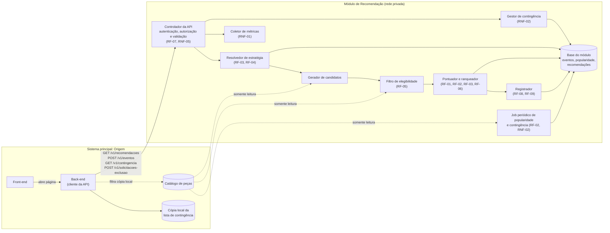
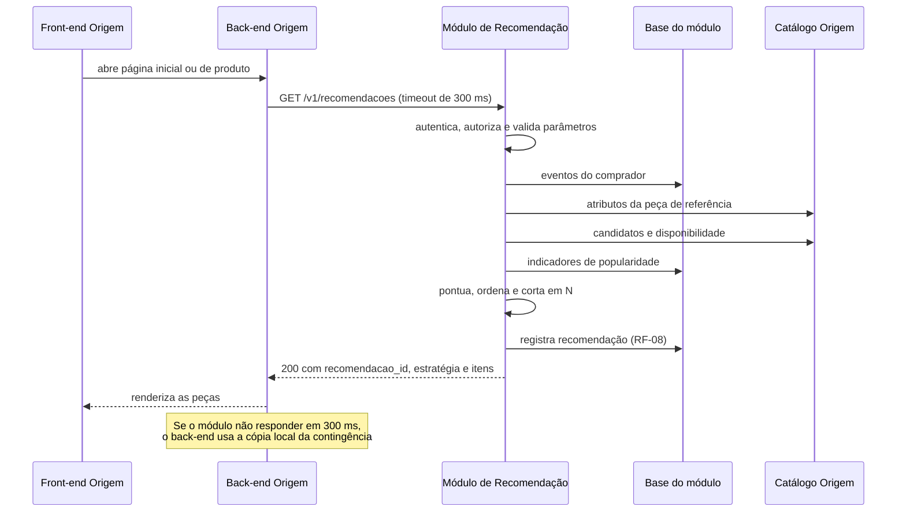

# design.md: Módulo de Recomendação de Produtos

> Projeto principal: **Origem**.

## 1. Diagrama de Componentes



| Componente | Responsabilidade | Requisitos |
|---|---|---|
| Controlador da API | Único ponto de entrada. Autentica a credencial de serviço, verifica se ela tem permissão para a operação, valida parâmetros, mede o tempo de resposta e devolve a resposta ou o erro. | RF-07, RNF-01, RNF-05 |
| Resolvedor de estratégia | Busca os eventos do comprador autenticado e decide entre estratégia personalizada e cold start; verifica se a peça de referência é válida. | RF-01, RF-03, RF-04 |
| Gerador de candidatos | Monta o conjunto de peças que podem ser pontuadas (seção 4.1). | RF-01, RF-02, RF-03 |
| Filtro de elegibilidade | Remove peças com estoque zero, despublicadas e a própria peça de referência, consultando o catálogo a cada requisição. | RF-01, RF-05 |
| Pontuador e ranqueador | Calcula a pontuação final, ordena (por grupos de similaridade quando há peça de referência), aplica desempate,  corta a lista em N e, se faltar item, completa com elegíveis por popularidade (4.1). | RF-01, RF-02, RF-03, RF-06 |
| Gestor de contingência | Em caso de falha interna, responde com a lista de Mais Vendidos. | RNF-02 |
| Registrador | Grava recomendações geradas e eventos/interações recebidos. | RF-08, RF-09 |
| Job periódico | Recalcula os indicadores de popularidade e a lista de contingência. | RF-02, RNF-02 |
| Coletor de métricas | Expõe métricas e logs para monitoramento (seção 8.3). | RNF-01, RNF-04 |
| Base do módulo | Armazena eventos, indicadores de popularidade, lista de contingência e recomendações registradas. | RF-02, RF-03, RF-08, RF-09, RNF-03 |
| Catálogo de peças (Origem) | Fonte oficial de técnica, polo, estoque e publicação. O módulo tem acesso somente leitura. | RF-01, RF-05 |
| Cópia local da contingência (Origem) | Usada pelo back-end quando o módulo está inacessível. | RNF-02 |

## 2. Fluxo dos Dados

### 2.1 Solicitação de recomendação



1. O back-end do Origem chama `GET /v1/recomendacoes` com sessão, comprador (se autenticado), contexto, peça de referência (se houver) e quantidade N (RF-07).
2. O controlador autentica a credencial de serviço e verifica se ela tem permissão para a operação (RNF-05), e depois valida os parâmetros (RF-07). Se houver problema, retorna 401, 403 ou 400 e nada é registrado.
3. O resolvedor busca até os 50 eventos mais recentes do tipo `visualizacao` ou `compra` do `comprador_id` (RF-03). Havendo pelo menos um evento, a estratégia é `personalizada`; caso contrário, ou quando o `comprador_id` estiver ausente (visitante não autenticado), a estratégia é `cold_start` (RF-04).
4. Se houver `peca_referencia_id`, o resolvedor lê a peça no catálogo. Se ela não existir ou não tiver técnica artesanal, o critério de similaridade é desconsiderado (RF-01).
5. O gerador de candidatos monta o conjunto de peças a pontuar (seção 4.1).
6. O filtro remove peças com estoque zero, despublicadas e a própria peça de referência (RF-01, RF-05).
7. O pontuador calcula a pontuação final; havendo peça de referência válida, agrupa as peças por grau de similaridade (RF-01); ordena da maior para a menor pontuação dentro de cada grupo, desempata por popularidade e corta a lista em N (RF-02, RF-06).  Se a lista elegível tiver menos de N itens, o ranqueador completa com outras peças elegíveis por popularidade até N (seção 4.1).
8. O registrador grava a recomendação (RF-08) e o controlador retorna a resposta.
9. Se ocorrer falha interna em qualquer etapa de 3 a 7, o gestor de contingência responde com a lista de Mais Vendidos; se o catálogo estiver inacessível, o módulo responde 503 e o Origem usa sua cópia local (seção 7.2).

### 2.2 Eventos e interações do comprador

1. Sempre que o comprador visualiza uma peça, clica em uma recomendação, adiciona uma peça ao carrinho ou conclui uma compra, o back-end do Origem envia `POST /v1/eventos`.
2. Quando o evento veio de uma recomendação, o back-end inclui o `recomendacao_id` recebido em 2.1.
3. O registrador grava o evento imediatamente (sem fila), o que torna o evento disponível para a próxima recomendação do mesmo comprador (RF-03).
4. Se o `recomendacao_id` existir, o evento é gravado com vínculo `associada`; se foi informado mas não existe, com vínculo `avulsa` (RF-09); se não foi informado, com vínculo `nenhum`.

### 2.3 Recálculo periódico (a cada 60 minutos)

1. O job soma, por peça, as compras e visualizações da janela de 30 dias (RF-02).
2. Calcula a pontuação de popularidade normalizada (seção 4.1) e grava em `IndicadorPopularidade`.
3. Gera uma nova `ListaContingencia` com as 50 peças de maior popularidade que estejam disponíveis no catálogo nesse momento (RNF-02).
4. O back-end do Origem consulta `GET /v1/contingencia` a cada 15 minutos e atualiza sua cópia local.
5. Um job diário executa a limpeza da base, apagando registros da tabela `EventoComprador` com `ocorrido_em` superior a 90 dias (`janela_retencao_eventos_dias`). Os indicadores agregados de popularidade permanecem inalterados.

### 2.4 Exclusão de dados do comprador

1. O comprador solicita a exclusão dos seus dados no Origem.
2. O back-end envia `POST /v1/solicitacoes-exclusao` com o `comprador_id` e os `sessao_id` conhecidos desse comprador.
3. O módulo apaga os eventos e as recomendações registradas associados a esses identificadores e retorna a contagem de registros excluídos (RNF-03). Os indicadores de popularidade não são alterados, pois são agregados e não identificam ninguém.

## 3. Modelo de Dados

| Entidade | Campos | Uso |
|---|---|---|
| `PecaCatalogo` (somente leitura, pertence ao Origem) | `peca_id`, `artesao_id`, `tecnica_artesanal` (pode ser nula), `polo_origem` (pode ser nulo), `estoque` (inteiro), `publicada` (booleano) | Similaridade (RF-01) e elegibilidade (RF-05). `artesao_id` é usado apenas na métrica de cobertura (8.3). |
| `EventoComprador` | `evento_id`, `comprador_id` (pseudonimizado; nulo para visitante), `sessao_id`, `peca_id`, `tipo` (`visualizacao`, `clique`, `adicao_carrinho`, `compra`), `recomendacao_id` (nulo quando não associado), `vinculo` (`associada`, `avulsa`, `nenhum`), `ocorrido_em`, `recebido_em` | Histórico: `visualizacao` e `compra` com `comprador_id` preenchido (RF-03, RF-04). Popularidade: `visualizacao` e `compra` (RF-02). Interações com recomendações: eventos com vínculo `associada` ou `avulsa` (RF-09). |
| `IndicadorPopularidade` | `peca_id`, `vendas_janela`, `visualizacoes_janela`, `pontuacao` (0 a 1), `janela_dias`, `calculado_em` | RF-02, RF-04 |
| `ListaContingencia` | `versao`, `itens` (lista ordenada de `peca_id`), `calculado_em` | RNF-02 |
| `RecomendacaoGerada` | `recomendacao_id`, `comprador_id` (nulo para visitante), `sessao_id`, `contexto`, `peca_referencia_id` (nulo), `estrategia` (`personalizada`, `cold_start`, `contingencia`), `itens` (lista de `peca_id`, `posicao`, `pontuacao`), `gerado_em`, `tempo_processamento_ms` | RF-08, RNF-01 |

**Parâmetros de configuração**

| Parâmetro | Valor inicial | Requisito |
|---|---|---|
| `limite_padrao` | 10 itens | RF-06 |
| `limite_maximo` | 50 itens | RF-06 |
| `janela_popularidade_dias` | 30 dias | RF-02 |
| `peso_venda` | 5 (uma venda vale cinco visualizações) | RF-02 |
| `intervalo_recalculo_min` | 60 minutos | RF-02, RNF-02 |
| `max_eventos_historico` | 50 eventos mais recentes | RF-03, RNF-01 |
| `candidatos_populares` | 100 peças | seção 4.1 |
| Pesos por situação | tabela da seção 4.2 | RF-01 a RF-04 |
| `tamanho_lista_contingencia` | 50 peças (igual a `limite_maximo`) | RNF-02 |
| No back-end do Origem: `timeout_chamada_ms` | 300 ms | RNF-02 |
| No back-end do Origem: `intervalo_copia_contingencia_min` | 15 minutos | RNF-02 |

O timeout de 300 ms é maior que a meta de 200 ms do RNF-01 de propósito: a meta vale para 95% das requisições, e o timeout só aciona a cópia local quando o módulo está claramente degradado.

## 4. Estratégia Principal e Baseline

### 4.1 Sinais e pontuação

A estratégia principal é **híbrida**: cada peça candidata recebe três sinais entre 0 e 1, combinados por pesos.

```
pontuacao_final = w_sim * s_sim + w_hist * s_hist + w_pop * s_pop
```

**Similaridade com a peça de referência, `s_sim` (RF-01)**

| Situação da candidata em relação à peça de referência | `s_sim` |
|---|---|
| Mesma técnica artesanal e mesmo polo de origem | 1,0 |
| Mesma técnica artesanal, polo diferente | 0,7 |
| Técnica diferente | 0 |

**Afinidade com o histórico, `s_hist` (RF-03)**

Para cada evento `e` do histórico (até 50 eventos de `visualizacao` ou `compra`), com peso 3 para compra e 1 para visualização:

```
s_hist(c) = soma[ peso(e) * (0,7 * mesma_tecnica(e, c) + 0,3 * mesmo_polo(e, c)) ] / soma[ peso(e) ]
```

`mesma_tecnica` e `mesmo_polo` valem 1 quando o atributo da peça do evento é igual ao da candidata `c`, e 0 caso contrário.

**Popularidade, `s_pop` (RF-02)**

```
bruto(p) = peso_venda * vendas_janela(p) + visualizacoes_janela(p)
s_pop(p) = ln(1 + bruto(p)) / ln(1 + maior_bruto_do_catalogo)
```

Quando nenhuma peça tem vendas ou visualizações, `s_pop = 0` para todas. O logaritmo reduz a vantagem das poucas peças muito populares sobre as demais (ver vieses, seção 8.4). Peça sem vendas nem visualizações tem `s_pop = 0`, a menor pontuação possível, mas continua elegível (RF-02).

**Geração de candidatos**

O conjunto de candidatas é a união de:

- peças com a mesma técnica da peça de referência, quando ela é válida (RF-01);
- peças com técnica ou polo presentes no histórico, quando há histórico (RF-03);
- as 100 peças de maior popularidade (RF-02).

**Ordenação e desempate**

Quando há peça de referência válida, as peças são ordenadas primeiro pelo grau de similaridade: mesma técnica e mesmo polo, depois mesma técnica com polo diferente, depois técnica diferente (RF-01). Dentro de cada grupo, a ordem é por `pontuacao_final` decrescente; em caso de empate, vence a de maior `s_pop` (RF-02) e, persistindo o empate, a de menor `peca_id`, para que a ordem seja determinística. Sem peça de referência, as peças são ordenadas diretamente por `pontuacao_final`, com o mesmo desempate. O campo `criterios` da resposta lista os sinais com contribuição maior que zero. 

**Relação com RF-02 e RF-04.** No cold start sem peça de referência e sem histórico, `w_pop`= 1,0 e a lista sai estritamente ordenada por popularidade, como pede RF-04. Nas demais situações, popularidade entra como sinal (`s_pop`) e como critério de desempate, conforme a seção 4.2; a ordenação é pela `pontuacao_final` da estratégia híbrida, dentro dos grupos de similaridade quando há peça de referência. A baseline (4.3) é exatamente a ordenação por popularidade e serve de referência para RF-02. 

**Garantia de N itens (RF-04, RF-06).** Se, após a filtragem de elegibilidade, restarem menos de N peças, o ranqueador completa a lista com outras peças elegíveis do catálogo, ordenadas por `s_pop` decrescente, até atingir N ou esgotar as peças elegíveis. Assim, sempre que existirem pelo menos N peças elegíveis, a resposta contém N itens (RF-06); a lista só fica menor que N quando o catálogo não tem peças elegíveis suficientes.

### 4.2 Pesos por situação

| Peça de referência válida? | Histórico válido? | `w_sim` | `w_hist` | `w_pop` | `estrategia` |
|---|---|---|---|---|---|
| Sim | Sim | 0,5 | 0,3 | 0,2 | `personalizada` |
| Não | Sim | 0 | 0,7 | 0,3 | `personalizada` |
| Sim | Não | 0,7 | 0 | 0,3 | `cold_start` |
| Não | Não | 0 | 0 | 1,0 | `cold_start` |

Os pesos são valores iniciais definidos em configuração e ajustados pela avaliação da seção 4.4. A prioridade da similaridade na página de produto é garantida pela ordenação em grupos (4.1); os pesos definem a ordem dentro de cada grupo (RF-01). No cold start, a similaridade continua valendo quando existe peça de referência (RF-04). 

### 4.3 Baseline

A **baseline** é a lista de **Mais Vendidos**: as peças elegíveis ordenadas apenas por `s_pop`. Ela foi escolhida por ser a solução mais simples possível, não depender de dados pessoais e já existir no sistema como lista de contingência (RNF-02). A estratégia principal só se justifica se superar a baseline na avaliação abaixo.

### 4.4 Avaliação e recalibração

**Avaliação offline (mensal).** Para cada compra dos últimos 30 dias cujo comprador tinha pelo menos um evento anterior:

1. reconstrói-se o histórico e a popularidade existentes antes da compra;
2. gera-se a lista de 10 itens pela estratégia principal e pela baseline;
3. verifica-se se a peça comprada aparece na lista.

A métrica é o **hit rate@10**: proporção de compras em que a peça comprada apareceu entre os 10 itens. O filtro de estoque (RF-05) é ignorado na simulação, pois o estado do estoque no passado não é armazenado.

**Acompanhamento online (contínuo).** A partir dos registros de RF-08 e RF-09, calculam-se a taxa de clique (cliques divididos por recomendações exibidas) e a taxa de compra por estratégia e por contexto. Esses números são descritivos, e não uma comparação direta entre estratégias, pois compradores com e sem histórico são grupos diferentes.

**Recalibração.** O "retreinamento" citado em RF-09 corresponde, neste design, ao ajuste dos pesos da seção 4.2 e do `peso_venda`. Se o hit rate@10 da estratégia principal não superar o da baseline, a equipe testa outras combinações de pesos com a mesma avaliação offline e atualiza a configuração com a melhor combinação.

## 5. Interface de Integração

**Convenções gerais**

- Prefixo `/v1`, JSON em UTF-8, HTTPS dentro da rede privada.
- Todas as chamadas exigem o cabeçalho `Authorization: Bearer <token_de_servico>`, e cada credencial só pode usar as operações permitidas a ela (RNF-05, seção 8.1).
- `comprador_id` é sempre o identificador pseudonimizado gerado pelo Origem (seção 8.2).
- Formato padrão de erro:

```json
{
  "erro": {
    "codigo": "PARAMETRO_INVALIDO",
    "campo": "limite",
    "mensagem": "limite deve ser um número inteiro maior ou igual a 1"
  }
}
```

### 5.1 `GET /v1/recomendacoes` (interface principal, RF-07)

**Campos de entrada (query string)**

| Campo | Tipo | Obrigatório | Regras | Requisito |
|---|---|---|---|---|
| `sessao_id` | string (até 64 caracteres) | Sim | Identificador da sessão atual, autenticada ou não. | RF-08 |
| `comprador_id` | string (até 64 caracteres) | Não | Identificador pseudonimizado; ausente para visitante não autenticado. | RF-03, RF-08 |
| `contexto` | string | Sim | `pagina_inicial` ou `pagina_produto`. | RF-08 |
| `peca_referencia_id` | string | Não | Peça em exibição. Se inexistente ou sem técnica, o critério de similaridade é ignorado (não é erro). | RF-01 |
| `limite` | inteiro | Não | Maior ou igual a 1. Ausente: `limite_padrao`. Acima de `limite_maximo`: truncado. | RF-06 |

**Campos de saída (200 OK)**

| Campo | Tipo | Descrição | Requisito |
|---|---|---|---|
| `recomendacao_id` | string | Identificador a ser reenviado em `POST /v1/eventos`. | RF-08, RF-09 |
| `estrategia` | string | `personalizada`, `cold_start` ou `contingencia`. | RF-04, RF-07, RNF-02 |
| `contexto` | string | Mesmo valor recebido. | RF-08 |
| `gerado_em` | string (ISO 8601) | Data e hora da geração. | RF-08 |
| `itens` | lista | Ordenada; até N itens; pode ter menos itens ou estar vazia. | RF-06 |
| `itens[].peca_id` | string | Identificador da peça no catálogo do Origem. | RF-07 |
| `itens[].posicao` | inteiro | Posição na lista, começando em 1. | RF-07 |
| `itens[].pontuacao` | número (0 a 1) ou `null` | Pontuação final; `null` em contingência. | seção 4 |
| `itens[].criterios` | lista de strings | Sinais que contribuíram: `similaridade`, `historico`, `popularidade` ou `mais_vendidos`. | RF-01 a RF-04 |

**Mapeamento de nomes.** Os valores da API usam `snake_case`; os requisitos usam a forma por extenso. `personalizada` = estratégia personalizada (RF-03), `cold_start` = estratégia de cold start (RF-04), `contingencia` = estratégia de contingência (RNF-02, RF-08).

**Erros possíveis**

| HTTP | `codigo` | Quando ocorre | Requisito |
|---|---|---|---|
| 400 | `PARAMETRO_AUSENTE` | `sessao_id` ou `contexto` não informado. | RF-07 |
| 400 | `PARAMETRO_INVALIDO` | `contexto` fora dos valores permitidos, `limite` não inteiro ou menor que 1, identificador acima do tamanho máximo. | RF-07 |
| 401 | `NAO_AUTENTICADO` | Credencial de serviço ausente, inválida ou expirada. | RNF-05 |
| 403 | `SEM_PERMISSAO` | Credencial válida sem permissão para `recomendacoes:ler`. | RNF-05 |
| 503 | `SERVICO_INDISPONIVEL` | Falha interna sem lista de contingência calculada (ex.: primeira implantação) ou com o catálogo inacessível. O Origem usa sua cópia local. | RNF-02 |

Falha interna com lista de contingência disponível e catálogo acessível **não** gera erro: a resposta é 200 com `estrategia: "contingencia"` (RNF-02).

### 5.2 `POST /v1/eventos` (RF-02, RF-03, RF-09)

**Campos de entrada (corpo JSON)**

| Campo | Tipo | Obrigatório | Regras |
|---|---|---|---|
| `sessao_id` | string | Sim | Mesma sessão usada nas recomendações. |
| `comprador_id` | string | Não | Pseudonimizado; ausente para visitante. |
| `peca_id` | string | Sim | Peça envolvida no evento. |
| `tipo` | string | Sim | `visualizacao`, `clique`, `adicao_carrinho` ou `compra`. |
| `recomendacao_id` | string | Não | Informado quando o evento veio de uma recomendação. |
| `ocorrido_em` | string (ISO 8601) | Sim | Momento do evento no Origem. |

**Campos de saída (202 Accepted)**: `evento_id` (string) e `vinculo` (`associada`, `avulsa` ou `nenhum`).

**Erros possíveis**: 400 `PARAMETRO_AUSENTE` (campo obrigatório ausente); 400 `PARAMETRO_INVALIDO` (`tipo` desconhecido ou data inválida); 401 `NAO_AUTENTICADO`; 403 `SEM_PERMISSAO` (credencial sem `eventos:registrar`). Um `recomendacao_id` inexistente **não** é erro: o evento é gravado com `vinculo: "avulsa"` (RF-09).

### 5.3 `GET /v1/contingencia` (RNF-02)

**Entrada**: nenhum parâmetro.

**Saída (200 OK)**: `versao` (string), `calculado_em` (ISO 8601) e `itens` (lista de `peca_id` e `posicao`, até 50 peças).

**Erros possíveis**: 401 `NAO_AUTENTICADO`; 403 `SEM_PERMISSAO` (credencial sem `contingencia:ler`); 503 `SERVICO_INDISPONIVEL` quando nenhuma lista foi calculada ainda.

### 5.4 `POST /v1/solicitacoes-exclusao` (RNF-03)

**Entrada (corpo JSON)**: `comprador_id` (obrigatório) e `sessao_ids` (lista, opcional).

**Saída (200 OK)**: `eventos_excluidos` e `recomendacoes_excluidas` (inteiros). A operação é idempotente: repetir a solicitação retorna contagens zero.

**Erros possíveis**: 400 `PARAMETRO_AUSENTE`; 401 `NAO_AUTENTICADO`; 403 `SEM_PERMISSAO` (credencial sem `dados:excluir`).

## 6. Exemplos de Requisição e Resposta

### 6.1 Estratégia personalizada, página de produto

```http
GET /v1/recomendacoes?sessao_id=s-8f21&comprador_id=c-3a9e&contexto=pagina_produto&peca_referencia_id=p-456&limite=3
Authorization: Bearer <token_de_servico>
```

```json
{
  "recomendacao_id": "rec-20260916-000123",
  "estrategia": "personalizada",
  "contexto": "pagina_produto",
  "gerado_em": "2026-09-16T14:32:05Z",
  "itens": [
    { "peca_id": "p-789", "posicao": 1, "pontuacao": 0.86, "criterios": ["similaridade", "historico", "popularidade"] },
    { "peca_id": "p-212", "posicao": 2, "pontuacao": 0.70, "criterios": ["similaridade", "historico", "popularidade"] },
    { "peca_id": "p-330", "posicao": 3, "pontuacao": 0.36, "criterios": ["historico", "popularidade"] }
  ]
}
```

Cálculo do primeiro item com os pesos da seção 4.2 (`w_sim` 0,5; `w_hist` 0,3; `w_pop` 0,2): mesma técnica e polo (`s_sim` = 1,0), `s_hist` = 0,8 e `s_pop` = 0,6, resultando em 0,5 + 0,24 + 0,12 = 0,86.

### 6.2 Cold start, página inicial, visitante sem histórico

```http
GET /v1/recomendacoes?sessao_id=s-11c4&contexto=pagina_inicial&limite=5
Authorization: Bearer <token_de_servico>
```

```json
{
  "recomendacao_id": "rec-20260916-000124",
  "estrategia": "cold_start",
  "contexto": "pagina_inicial",
  "gerado_em": "2026-09-16T14:32:07Z",
  "itens": [
    { "peca_id": "p-001", "posicao": 1, "pontuacao": 1.00, "criterios": ["popularidade"] },
    { "peca_id": "p-045", "posicao": 2, "pontuacao": 0.94, "criterios": ["popularidade"] },
    { "peca_id": "p-118", "posicao": 3, "pontuacao": 0.91, "criterios": ["popularidade"] },
    { "peca_id": "p-067", "posicao": 4, "pontuacao": 0.88, "criterios": ["popularidade"] },
    { "peca_id": "p-203", "posicao": 5, "pontuacao": 0.85, "criterios": ["popularidade"] }
  ]
}
```

### 6.3 Contingência por falha interna

```json
{
  "recomendacao_id": "rec-20260916-000125",
  "estrategia": "contingencia",
  "contexto": "pagina_inicial",
  "gerado_em": "2026-09-16T14:32:09Z",
  "itens": [
    { "peca_id": "p-001", "posicao": 1, "pontuacao": null, "criterios": ["mais_vendidos"] },
    { "peca_id": "p-045", "posicao": 2, "pontuacao": null, "criterios": ["mais_vendidos"] }
  ]
}
```

### 6.4 Erro de parâmetro inválido

```http
GET /v1/recomendacoes?sessao_id=s-11c4&contexto=pagina_inicial&limite=abc
```

```json
{
  "erro": {
    "codigo": "PARAMETRO_INVALIDO",
    "campo": "limite",
    "mensagem": "limite deve ser um número inteiro maior ou igual a 1"
  }
}
```

### 6.5 Interação com recomendação inexistente (registro avulso)

```http
POST /v1/eventos
Authorization: Bearer <token_de_servico>
Content-Type: application/json

{
  "sessao_id": "s-8f21",
  "comprador_id": "c-3a9e",
  "peca_id": "p-789",
  "tipo": "adicao_carrinho",
  "recomendacao_id": "rec-inexistente",
  "ocorrido_em": "2026-09-16T14:33:10Z"
}
```

```json
{ "evento_id": "ev-000981", "vinculo": "avulsa" }
```

## 7. Tratamento de Erros e Estratégia de Contingência

### 7.1 Situações tratadas

| Situação | Resposta | Registro | Requisito |
|---|---|---|---|
| `sessao_id` ou `contexto` ausente | 400 `PARAMETRO_AUSENTE` | Não registra | RF-07 |
| `contexto` inválido, `limite` não inteiro ou menor que 1 | 400 `PARAMETRO_INVALIDO` | Não registra | RF-07 |
| Credencial ausente, inválida ou expirada | 401 `NAO_AUTENTICADO` | Não registra | RNF-05 |
| Credencial válida sem permissão para a operação | 403 `SEM_PERMISSAO` | Não registra | RNF-05 |
| `limite` ausente | 200 com `limite_padrao` itens | Registra | RF-06 |
| `limite` acima do máximo | 200 com no máximo `limite_maximo` itens | Registra | RF-06 |
| Menos peças elegíveis que N | 200 com todas as elegíveis (a lista pode ficar vazia) | Registra | RF-06 |
| Comprador sem histórico ou visitante não autenticado | 200 com `cold_start` | Registra | RF-04 |
| Peça de referência inexistente ou sem técnica | 200 sem o critério de similaridade | Registra | RF-01 |
| Peça esgotada ou despublicada entre as candidatas | Removida da lista | Registra sem ela | RF-05 |
| Falha interna (erro de cálculo ou base do módulo), com catálogo acessível | 200 com `contingencia` | Tenta registrar; se o registro também falhar, responde mesmo assim e incrementa a métrica de falhas de registro | RNF-02, RF-08 |
| Catálogo inacessível | 503 `SERVICO_INDISPONIVEL`; o Origem usa a cópia local filtrada pelo próprio catálogo | Não registra | RF-05, RNF-02 |
| Falha interna sem nenhuma lista de contingência calculada | 503 `SERVICO_INDISPONIVEL` | Não registra | RNF-02 |
| Módulo inacessível ou sem resposta em 300 ms | Origem usa a cópia local; sem cópia local, oculta o bloco de recomendações | Sem registro no módulo | RNF-02 |
| Evento com `recomendacao_id` inexistente | 202 com `vinculo: "avulsa"` | Registra avulso | RF-09 |
| Evento com campo obrigatório ausente ou inválido | 400 | Não registra | RF-09 |

> **Nota sobre RF-08.** O registro da recomendação é síncrono e *best-effort*: se a gravação falhar, a resposta ainda é entregue (RNF-02 tem precedência sobre o registro completo) e a ocorrência é contabilizada na métrica `Falhas de registro` (8.3), que dispara alerta a cada ocorrência. Não há fila de retry no escopo atual; a reconciliação é feita a partir do log estruturado da requisição, que preserva `recomendacao_id`, estratégia e itens.

### 7.2 Contingência em duas camadas (RNF-02)

**Camada 1: falha interna, módulo acessível.** O gestor de contingência lê a `ListaContingencia` mais recente, remove as peças indisponíveis consultando o catálogo, corta em N e responde 200 com `estrategia: "contingencia"`. A recomendação é registrada normalmente (RF-08). Enquanto a falha persistir, toda nova requisição recebe a contingência; quando a operação normal volta, a próxima requisição já é calculada normalmente, pois a decisão é tomada a cada chamada.

**Catálogo inacessível.** Se o catálogo estiver inacessível, o módulo não tem como verificar a disponibilidade das peças e responde 503. O back-end do Origem aplica então a camada 2, e nenhuma peça esgotada ou despublicada é exibida (RF-05).

**Camada 2: módulo inacessível.** O back-end do Origem não recebe resposta em 300 ms ou recebe 503. Ele usa a cópia local da lista (atualizada a cada 15 minutos por `GET /v1/contingencia`), filtra as peças indisponíveis no próprio catálogo e renderiza o bloco. Assim o sistema principal continua funcionando sem depender do módulo.

## 8. Segurança, Privacidade e Observabilidade

### 8.1 Segurança

- **Rede:** o módulo roda em rede privada, sem rota pública. Apenas o back-end do Origem alcança a API.
- **Autenticação (RNF-05):** o sistema principal emite as credenciais de serviço (tokens) e as registra no módulo, que guarda apenas o hash de cada uma com sua data de expiração. O token viaja no cabeçalho `Authorization`, fica em variável de ambiente ou cofre de segredos (nunca no código-fonte) e é substituído periodicamente. Requisição sem credencial válida recebe 401.
- **Autorização (RNF-05):** cada credencial tem uma lista de permissões por operação: `recomendacoes:ler`, `eventos:registrar`, `contingencia:ler` e `dados:excluir`. A credencial usada pelo back-end nas páginas do marketplace recebe as três primeiras; `dados:excluir` fica em uma credencial separada, usada apenas pela rotina de privacidade do Origem. Credencial válida sem a permissão necessária recebe 403.
- **Transporte:** comunicação com TLS (HTTPS).
- **Menor privilégio:** o módulo acessa o catálogo com um usuário de banco somente leitura, limitado às colunas de `PecaCatalogo`.
- **Validação de entrada:** tipos, valores permitidos e tamanhos máximos são verificados antes de qualquer consulta, e as consultas usam parâmetros (sem concatenar texto recebido), prevenindo injeção.

### 8.2 Privacidade (RNF-03)

- **Pseudonimização:** o Origem gera `comprador_id` como HMAC-SHA256 do identificador interno do usuário com uma chave secreta que fica somente no Origem. O módulo não consegue descobrir quem é a pessoa e nunca recebe nome, e-mail, CPF, endereço ou dados de pagamento.
- **Por que pseudonimizar e não anonimizar o histórico:** o histórico precisa continuar ligado ao mesmo comprador para RF-03, e o direito de exclusão exige localizar os registros de uma pessoa. Dados totalmente anonimizados impediriam as duas coisas.
- **Dados agregados anonimizados:** `IndicadorPopularidade` e `ListaContingencia` guardam apenas contagens por peça, sem nenhum identificador de comprador.
- **Minimização:** o módulo armazena apenas os campos listados na seção 3.
- **Exclusão:** atendida por `POST /v1/solicitacoes-exclusao` (seções 2.4 e 5.4).
- **Logs:** registram apenas identificadores pseudonimizados e códigos técnicos, nunca o conteúdo completo das requisições.

### 8.3 Observabilidade

Cada requisição gera um log estruturado com `recomendacao_id`, `estrategia`, `contexto`, código HTTP e `tempo_processamento_ms`. As métricas abaixo são coletadas continuamente:

| Métrica | Como é medida | Alerta | Requisito |
|---|---|---|---|
| Latência p95 de `GET /v1/recomendacoes` | Tempo entre o recebimento da requisição e o envio da resposta, medido dentro do controlador da API | p95 acima de 200 ms por 5 minutos | RNF-01 |
| Taxa de erros | Percentual de respostas 4xx e 5xx | 5xx acima de 1% por 5 minutos | RF-07 |
| Rejeições de acesso | Quantidade de respostas 401 e 403, por credencial | Mais de 10 rejeições por minuto | RNF-05 |
| Taxa de contingência | Percentual de respostas com `estrategia: "contingencia"` | Acima de 5% por 5 minutos | RNF-02 |
| Uso da cópia local | Contador no back-end do Origem sempre que a camada 2 é acionada | Qualquer uso por mais de 5 minutos | RNF-02 |
| Idade da popularidade | Tempo desde o último `calculado_em` | Acima de 2 vezes `intervalo_recalculo_min` | RF-02 |
| Falhas de registro | Recomendações entregues sem registro gravado | Qualquer ocorrência | RF-08 |
| Taxa de clique e de compra | Eventos associados divididos por recomendações, por estratégia e contexto | Sem alerta; revisão mensal | RF-08, RF-09 |
| Cobertura | Percentual de peças elegíveis e número de artesãos distintos que apareceram em pelo menos uma recomendação nos últimos 7 dias | Queda de cobertura em relação ao mês anterior | Vieses (8.4) |

**Verificação de escalabilidade (RNF-04).** O volume de referência é a média de requisições por segundo no horário de maior movimento da semana anterior; antes do lançamento, é uma estimativa registrada pela equipe. O teste de carga executa 3 vezes esse volume por 10 minutos e verifica se a latência p95 permanece abaixo de 200 ms. O design favorece esse resultado porque a popularidade é pré-calculada pelo job (e não a cada requisição), o histórico é limitado a 50 eventos e a API não guarda estado entre chamadas, permitindo executar mais de uma instância em paralelo.

### 8.4 Vieses monitorados

- **Concentração por popularidade:** peças e artesãos que já vendem tendem a aparecer mais e, por isso, vender mais. A escala logarítmica de `s_pop` reduz esse efeito, e a métrica de cobertura permite detectá-lo.
- **Peças novas:** começam com `s_pop = 0` e, sem histórico ou similaridade, raramente entram na lista de cold start sem referência. Elas ainda aparecem pelos canais de similaridade e histórico.
- **Bolha de técnica:** a afinidade com o histórico pode restringir o comprador às mesmas técnicas. A presença obrigatória de `w_pop > 0` em todas as situações mantém peças de outras técnicas entre as candidatas.
- **Qualidade do cadastro:** técnicas e polos preenchidos de forma incompleta ou inconsistente pelos artesãos prejudicam a similaridade de forma desigual entre eles.

## 9. Restrições Técnicas Conhecidas

- Visitantes não autenticados não formam histórico e recebem sempre a estratégia de cold start; eventos gerados antes do login não são associados ao comprador depois que ele se autentica.
- Recomendações exibidas pela cópia local do Origem (camada 2) não são registradas no módulo; interações com essas peças chegam sem `recomendacao_id`.
- No lançamento há poucos eventos; a maioria das respostas será de cold start e os pesos iniciais são hipóteses até a primeira avaliação offline.
- O volume de referência para RNF-04 ainda precisa ser medido ou estimado pela equipe.
- O registro de recomendação é *best-effort*: em falha simultânea de cálculo e de gravação, a resposta é entregue sem registro e a métrica de falhas dispara alerta (ver nota em 7.1). Não há fila de retry no escopo atual.

## 10. Matriz de Rastreabilidade

| Requisito | Onde é atendido neste design |
|---|---|
| RF-01 | 2.1 (passos 4 e 6), 4.1 (`s_sim`), 4.2, 5.1 (`peca_referencia_id`), 7.1 |
| RF-02 | 2.3, 4.1 (`s_pop`, ordenação no cold start, desempate), 4.3, 3 (configuração) |
| RF-03 | 2.1 (passo 3), 2.2, 4.1 (`s_hist`), 5.2 |
| RF-04 | 2.1 (passo 3), 4.1 (garantia de N), 4.2, 6.2, 7.1 |
| RF-05 | 1 (filtro de elegibilidade), 2.1 (passo 6), 7.1, 7.2 (catálogo inacessível) |
| RF-06 | 3 (configuração), 4.1 (garantia de N), 5.1 (`limite`), 7.1 |
| RF-07 | 1 (controlador), 5, 6 |
| RF-08 | 2.1 (passo 8), 3 (`RecomendacaoGerada`), 7.1 (nota de best-effort) |
| RF-09 | 2.2, 3 (`EventoComprador`), 4.4, 5.2, 6.5 |
| RNF-01 | 3 (configuração), 8.3 (latência p95) |
| RNF-02 | 2.3, 5.3, 6.3, 7.2, 8.3 |
| RNF-03 | 2.4, 5.4, 8.2 |
| RNF-04 | 8.3 (teste de carga) |
| RNF-05 | 1 (controlador), 2.1 (passo 2), 5 (erros 401 e 403), 7.1, 8.1 |

